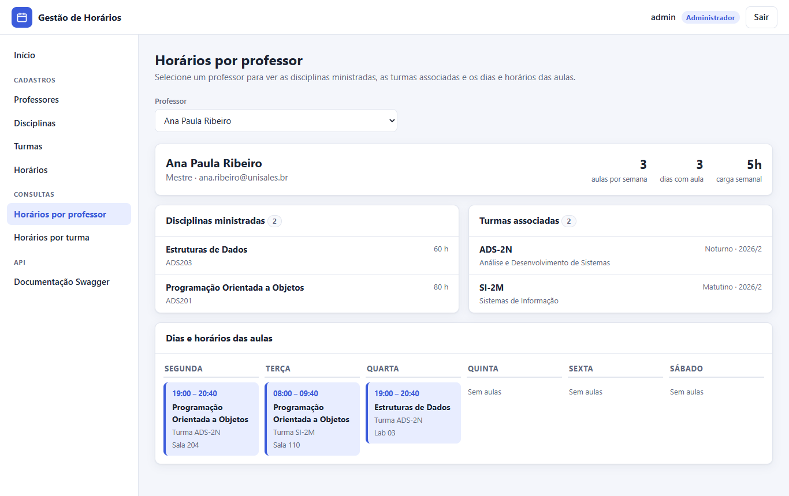
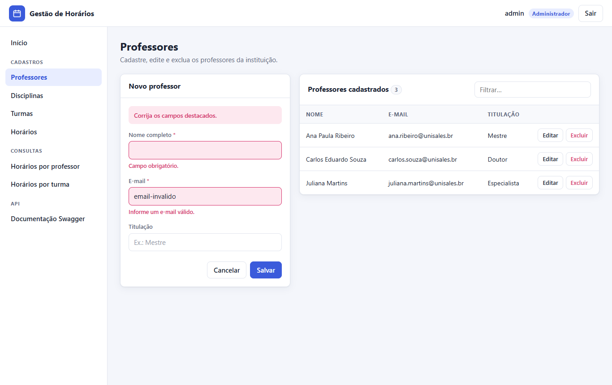
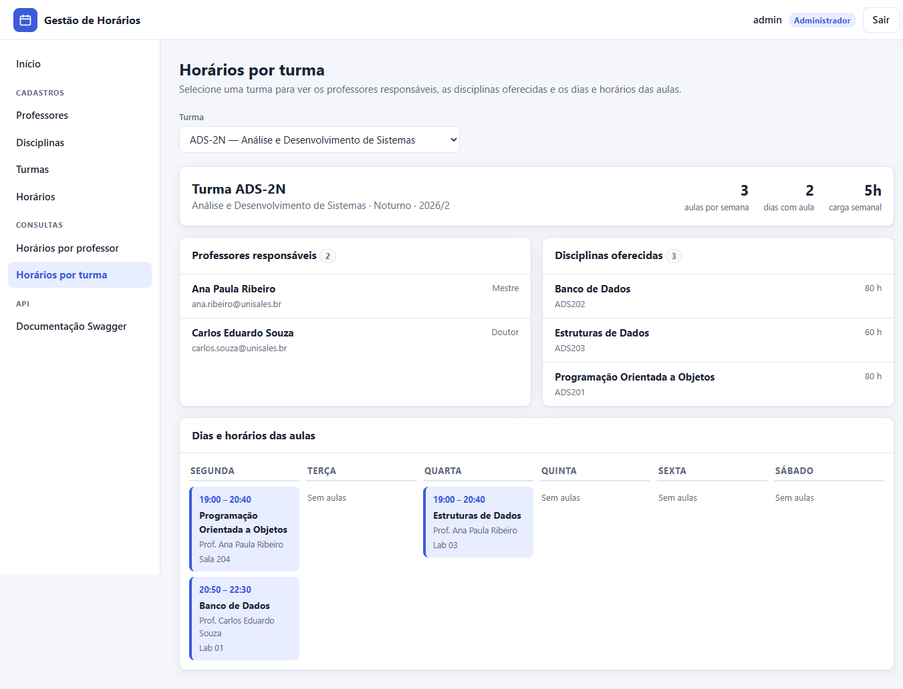

# Gestão de Horários de Aula

Aplicação web desenvolvida em Java com Spring Boot para organização e gerenciamento de horários de aula de professores. É composta por uma API REST documentada com Swagger (OpenAPI 3), protegida por autenticação HTTP Basic, e por uma interface web que consome essa API.



## Funcionalidades

- Telas de cadastro, edição, exclusão e listagem de professores, disciplinas, turmas e horários, com validação dos formulários.
- Visualização de horários por professor: disciplinas ministradas, turmas associadas e dias e horários das aulas.
- Visualização de horários por turma: professores responsáveis, disciplinas oferecidas e dias e horários das aulas.
- Controle de acesso por perfil: administrador (leitura e escrita) e consulta (somente leitura).
- Documentação interativa da API no Swagger UI.

## Tecnologias

- Java 17
- Spring Boot 4.1 (Web MVC, Data JPA, Validation, Security)
- Hibernate (ORM) com banco H2 em arquivo
- springdoc-openapi (Swagger UI)
- HTML, CSS e JavaScript (interface web servida pelo próprio Spring Boot)
- JUnit 5 e MockMvc
- Maven Wrapper

## Arquitetura

O projeto segue o padrão MVC em camadas, com separação de responsabilidades. Os controllers expõem a API REST, a interface web (camada de visão) é servida como conteúdo estático e conversa com o backend apenas pela API.

```
src/main
├── java/br/edu/unisales/horariosapi
│   ├── config       Segurança (HTTP Basic), Swagger e carga inicial de dados
│   ├── controller   Endpoints REST (camada de entrada)
│   ├── dto          Objetos de requisição e resposta com validações
│   ├── exception    Exceções de negócio e tratamento global de erros
│   ├── model        Entidades JPA (Professor, Disciplina, Turma, Horario, Usuario)
│   ├── repository   Interfaces Spring Data JPA
│   └── service      Regras de negócio
└── resources/static
    ├── index.html   Página única da interface web
    ├── css          Estilos
    └── js           api.js (cliente HTTP), crud.js (telas de cadastro),
                     agenda.js (consultas de horários), app.js (rotas e login)
```

## Modelo de dados

| Entidade   | Campos                                                                 |
|------------|------------------------------------------------------------------------|
| Professor  | id, nome, email (único), titulacao                                     |
| Disciplina | id, codigo (único), nome, cargaHoraria                                 |
| Turma      | id, nome (único), curso, anoLetivo, turno                              |
| Horario    | id, professor, disciplina, turma, diaSemana, horaInicio, horaFim, sala |
| Usuario    | id, username, senha (BCrypt), perfil                                   |

## Regras de negócio

- Validação dos dados de entrada (campos obrigatórios, e-mail, tamanhos, formatos).
- E-mail de professor, código de disciplina e nome de turma não podem se repetir.
- A hora de término deve ser posterior à hora de início.
- Um professor não pode ter duas aulas no mesmo dia em intervalos sobrepostos.
- Uma turma não pode ter duas aulas no mesmo dia em intervalos sobrepostos.
- Professores, disciplinas e turmas com horários vinculados não podem ser excluídos.

## Como executar

Pré-requisito: JDK 17 ou superior.

```bash
./mvnw spring-boot:run
```

No Windows:

```powershell
.\mvnw.cmd spring-boot:run
```

A aplicação sobe em `http://localhost:8080`.

- Interface web: `http://localhost:8080`
- Swagger UI: `http://localhost:8080/swagger-ui.html`
- OpenAPI JSON: `http://localhost:8080/v3/api-docs`

Na primeira execução são carregados professores, disciplinas, turmas e horários de exemplo.

## Interface web

| Tela | Descrição |
|------|-----------|
| Login | Entrada com usuário e senha |
| Início | Totais cadastrados e atalhos para as consultas |
| Professores, Disciplinas, Turmas, Horários | Formulário de cadastro e edição com validação, lista com filtro, edição e exclusão com confirmação |
| Horários por professor | Seleção do professor; disciplinas ministradas, turmas associadas e grade semanal das aulas |
| Horários por turma | Seleção da turma; professores responsáveis, disciplinas oferecidas e grade semanal das aulas |

Os formulários validam campos obrigatórios, formato de e-mail, limites de tamanho, carga horária entre 1 e 400, ano letivo no formato `AAAA` ou `AAAA/S` e término posterior ao início. Erros devolvidos pela API (duplicidade, choque de horário, exclusão com vínculos) são exibidos na tela. O perfil de consulta vê as listas e as consultas, sem as ações de alteração.

| Cadastro com validação | Horários por turma |
|---|---|
|  |  |

## Autenticação

A API usa autenticação HTTP Basic com usuários persistidos no banco.

| Usuário    | Senha         | Perfil   | Permissões                    |
|------------|---------------|----------|-------------------------------|
| `admin`    | `admin123`    | ADMIN    | Leitura e escrita             |
| `consulta` | `consulta123` | CONSULTA | Somente leitura (GET)         |

As credenciais podem ser alteradas pelas variáveis de ambiente `ADMIN_USUARIO`, `ADMIN_SENHA`, `CONSULTA_USUARIO` e `CONSULTA_SENHA`.

Na interface web, entre com usuário e senha na tela de login. No Swagger, clique em **Authorize** e informe usuário e senha.

## Endpoints

| Método | Rota                                  | Descrição                         |
|--------|---------------------------------------|-----------------------------------|
| GET    | `/api/professores`                    | Lista professores                 |
| GET    | `/api/professores/{id}`               | Busca professor                   |
| POST   | `/api/professores`                    | Cadastra professor                |
| PUT    | `/api/professores/{id}`               | Atualiza professor                |
| DELETE | `/api/professores/{id}`               | Exclui professor                  |
| GET    | `/api/disciplinas`                    | Lista disciplinas                 |
| GET    | `/api/disciplinas/{id}`               | Busca disciplina                  |
| POST   | `/api/disciplinas`                    | Cadastra disciplina               |
| PUT    | `/api/disciplinas/{id}`               | Atualiza disciplina               |
| DELETE | `/api/disciplinas/{id}`               | Exclui disciplina                 |
| GET    | `/api/turmas`                         | Lista turmas                      |
| GET    | `/api/turmas/{id}`                    | Busca turma                       |
| POST   | `/api/turmas`                         | Cadastra turma                    |
| PUT    | `/api/turmas/{id}`                    | Atualiza turma                    |
| DELETE | `/api/turmas/{id}`                    | Exclui turma                      |
| GET    | `/api/horarios`                       | Lista horários                    |
| GET    | `/api/horarios/{id}`                  | Busca horário                     |
| POST   | `/api/horarios`                       | Cadastra horário                  |
| PUT    | `/api/horarios/{id}`                  | Atualiza horário                  |
| DELETE | `/api/horarios/{id}`                  | Exclui horário                    |
| GET    | `/api/agenda/professores/{id}`        | Disciplinas, turmas e aulas do professor |
| GET    | `/api/agenda/turmas/{id}`             | Professores, disciplinas e aulas da turma |
| GET    | `/api/usuarios/me`                    | Usuário autenticado e perfil      |

### Exemplo de cadastro de horário

```bash
curl -u admin:admin123 -X POST http://localhost:8080/api/horarios \
  -H "Content-Type: application/json" \
  -d '{"professorId":1,"disciplinaId":1,"turmaId":2,"diaSemana":"SEXTA","horaInicio":"19:00","horaFim":"20:40","sala":"Sala 204"}'
```

### Códigos de resposta

| Código | Situação                                             |
|--------|------------------------------------------------------|
| 200    | Consulta ou atualização realizada                    |
| 201    | Recurso criado                                       |
| 204    | Recurso excluído                                     |
| 400    | Dados inválidos                                      |
| 401    | Não autenticado                                      |
| 403    | Sem permissão para a operação                        |
| 404    | Recurso não encontrado                               |
| 409    | Conflito (duplicidade, choque de horário, vínculos)  |
| 422    | Intervalo de horário inválido                        |

## Testes

```bash
./mvnw test
```
